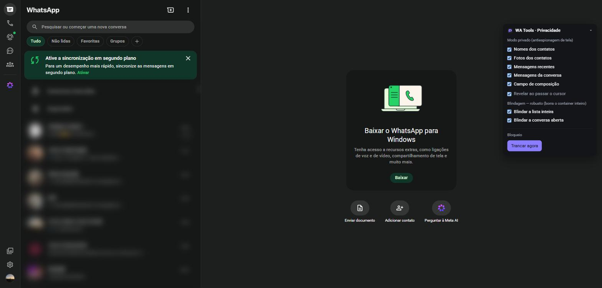
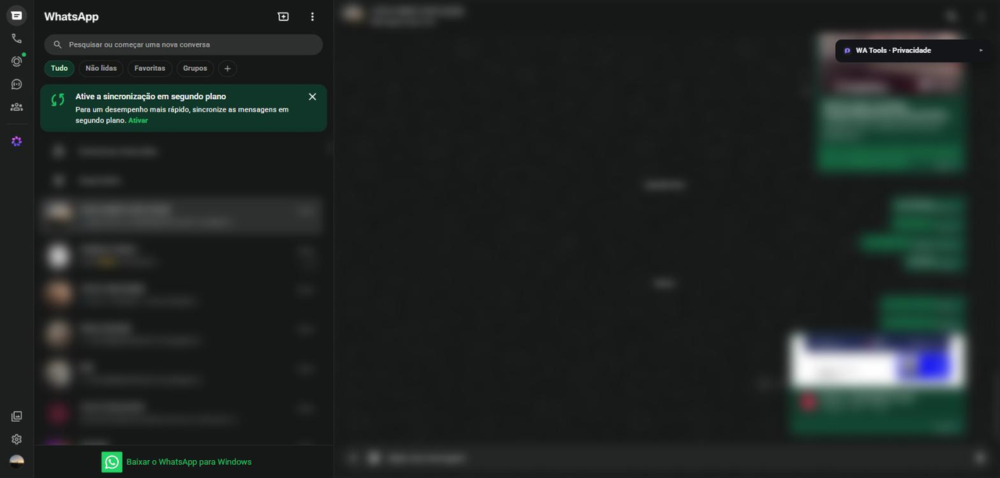
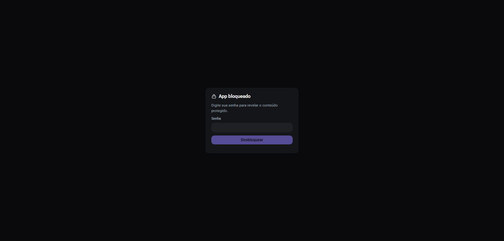

# WA Tools — Privacy

🇧🇷 [Versão em português](./README.pt-BR.md)

Browser extension (Chrome/Chromium, Manifest V3) that adds a **privacy and concealment layer** to WhatsApp Web. **100% local**: no accounts, no login, no servers, no monetization — nothing from your conversations leaves the device.

> ⚠️ Independent project, **not** affiliated with, associated with or endorsed by WhatsApp or Meta. "WhatsApp" is a trademark of Meta.

## Screenshots

**Screen privacy — anti-shoulder-surfing blur**



**Open conversation, protected**



**Password lock**



> Screenshots from a real account with **all content blurred by the extension itself** — nothing identifiable.

## What it does

**Privacy screen (anti-snooping)** — working:
- Blur names, photos, message previews, the open conversation and the compose field, with **reveal on hover**.
- **Region shielding** (robust): blurs the whole list and conversation, immune to changes in WhatsApp's DOM structure.
- Local **password lock** (PBKDF2 + lockout) — covers the content until you authenticate.

**Signal concealment** — logic done and tested, live integration in progress:
- Read without sending read receipts (blue ticks) **per conversation**, without reciprocity, including groups.
- Invisible mode (online + last seen), hide "typing…"/"recording…", play audio without a receipt.
- **Fail-safe**: if an internal WhatsApp hook breaks, the feature turns itself off and tells you — it never looks "active" without actually suppressing.

Out of scope by design: recovering deleted/view-once messages and bulk sending/broadcast.

## Privacy

- Minimal permissions: `storage`, `activeTab` and host `web.whatsapp.com`. **No** `webRequest`, `<all_urls>`, `unlimitedStorage` or `identity`.
- No network calls to first- or third-party servers. Settings live only in `chrome.storage.local`.
- Does not read or store message content — it only touches outgoing metadata (presence/receipts) and a local visual layer.

Full policy (in Portuguese): [PRIVACY.md](./PRIVACY.md).

## Stack

WXT (Manifest V3) · React 18 · Tailwind CSS v4 · TypeScript · Zod · Zustand · Vitest. Signal concealment uses [WA-JS](https://github.com/wppconnect-team/wa-js) under an isolated namespace.

## Development

```bash
pnpm install
pnpm dev        # WXT in watch mode (dev)
pnpm test       # Vitest (unit)
pnpm typecheck  # tsc --noEmit
pnpm build      # production build → .output/chrome-mv3/
pnpm zip        # package → .output/wa-tools-<version>-chrome.zip
pnpm gen:icons  # regenerate icons from assets/icon.svg
```

## Load unpacked (dev)

1. `pnpm build`
2. `chrome://extensions` → enable **Developer mode** → **Load unpacked** → select `.output/chrome-mv3/`.
3. Open `web.whatsapp.com` and reload.

## Status

- ✅ Privacy screen (blur + reveal + shielding) and password lock — verified live.
- 🚧 Signal concealment — modules done and tested; still missing the live wiring to WhatsApp internals + two-account E2E tests.
- Test suite: 110 unit tests.

## License

[MIT](./LICENSE).
